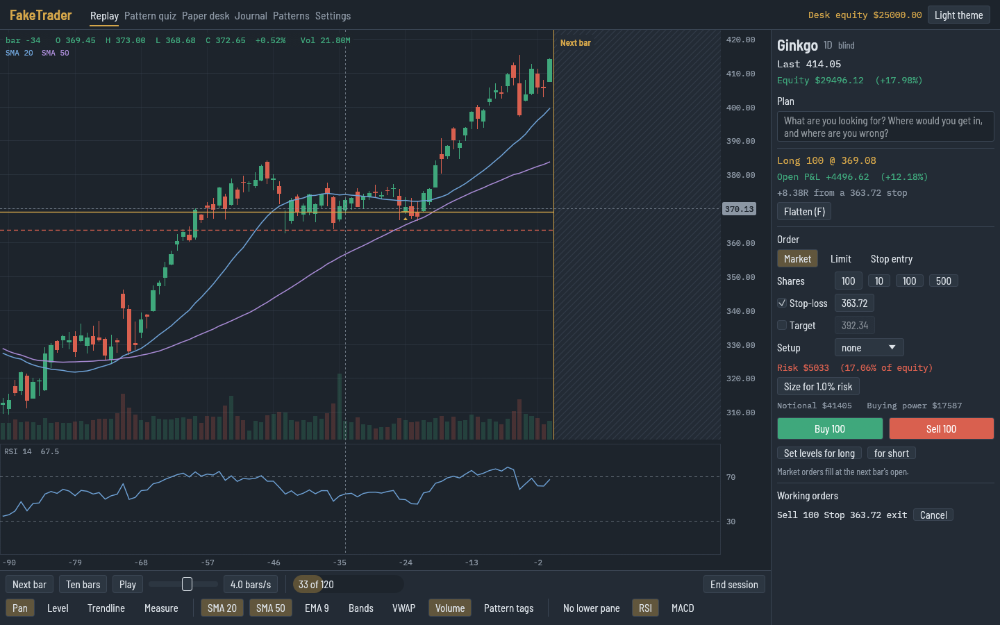
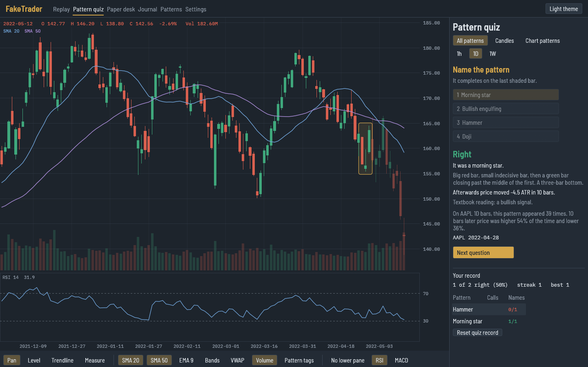
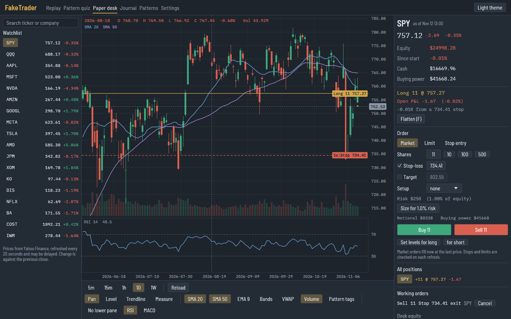

# FakeTrader

A desktop trainer for getting better at trading without paying the market for lessons. It uses real price history from Yahoo Finance, hides the future, and keeps score honestly.



## What you can do

**Replay drills.** FakeTrader picks a real chart and cuts it at a random date. By default the ticker and dates are hidden so you can't lean on what you remember. You step forward one bar at a time and trade with market, limit and stop orders, each with an optional stop-loss and target. When the session ends the curtain lifts: you see the ticker, what happened next, your return next to buy-and-hold, a letter grade and a few plain notes on what went wrong.

**Pattern quiz.** Every question is a real chart that has just completed a pattern. Some ask where price goes over the next 10 bars. Others ask you to name the pattern. After you answer you see the outcome and how often that pattern led to a higher close on that ticker. Your hit rate is tracked per pattern, so you can see which ones you read well and which you only think you do.



**Paper desk.** Trade current prices with a simulated account. Market orders fill at the last price. Stops and limits are checked on every refresh, including while you're on another tab.

**Journal.** Every closed trade from replays and the desk lands here with its R-multiple, best and worst excursion, and fees. You can tag the setup, grade how well you followed your plan and write notes. Stats break down by setup, and the journal exports to CSV.

**Patterns.** A reference for the 19 patterns the detector knows, with real examples pulled from your watchlist and the base rates FakeTrader measured on them.



## How fills work

The simulator errs on the side of making you look worse, not better:

- Market orders in replay fill at the next bar's open, plus slippage.
- A stop that price gaps through fills at the open, not at your stop price.
- If one bar touches both your stop and your target, the stop counts.
- Commission, slippage, leverage and shorting are all set in Settings.

The order ticket shows your dollar risk and the share of equity it represents before you click. "Size for 1% risk" sets the share count from your stop distance.

## Keys

| Key | Replay | Quiz | Desk |
| --- | --- | --- | --- |
| Space | next bar (Shift: ten) | | |
| P | play or pause | | |
| B / S | buy / sell | | buy / sell |
| F | flatten | | flatten |
| C | cancel orders | | |
| E | end session | | |
| 1 to 4 | | answer | |
| Enter | | next question | |

On the chart: drag to pan, scroll to zoom, double-click to jump back to the latest bar. Drag a dashed order line to move that order.

## Install

Download from the [releases page](https://github.com/TheWafool/faketrader/releases/latest).

**Arch, CachyOS, Manjaro (AUR-style build).** Paste this into a terminal. It downloads the PKGBUILD, builds the package from source and installs it:

```sh
mkdir -p /tmp/faketrader && cd /tmp/faketrader && curl -fsSLO https://github.com/TheWafool/faketrader/releases/latest/download/PKGBUILD && makepkg -si
```

You need `base-devel` and `rust` (or `rustup`) installed. The first build takes a few minutes.

**Debian, Ubuntu, Mint.** Download the `.deb`, then:

```sh
sudo apt install ./faketrader_*_amd64.deb
```

**Any Linux (AppImage).** Download the `.AppImage`, then:

```sh
chmod +x faketrader_*.AppImage && ./faketrader_*.AppImage
```

**Windows.** Run the `-setup.exe` installer (or the `.msi`). Windows SmartScreen may warn because the build is unsigned: choose More info, then Run anyway. A portable `.zip` with just the `.exe` is also attached.

**macOS.** Open the `.dmg` and drag FakeTrader to Applications. Pick the Apple silicon build for M-series Macs and the Intel build otherwise. The app is unsigned, so the first time, right-click it and choose Open.

### Build from source

You need a current stable Rust toolchain.

```sh
cargo run --release
```

On Linux the window needs the usual X11/Wayland and OpenGL libraries, which every desktop install already has.

To build installers for the platform you're on:

```sh
cargo install cargo-packager --locked
cargo build --release
cargo packager --release            # writes to dist/
```

The package recipe is in `packaging/aur/PKGBUILD`.

## Data

Prices come from Yahoo Finance's public chart endpoint and are cached on disk. Daily data refreshes every 6 hours, intraday every 2 minutes. If you're offline, the cached copy is used. Yahoo keeps 60 days of 5- and 15-minute bars and two years of hourly bars.

You can also import your own CSV (Date, Open, High, Low, Close, Volume) in Settings. It gets saved under the ticker name you give it.

Your journal, drill history, quiz record and desk account live in one JSON file:

- Linux: `~/.local/share/faketrader/state.json`
- macOS: `~/Library/Application Support/dev.FakeTrader.FakeTrader/state.json`
- Windows: `%APPDATA%\FakeTrader\FakeTrader\data\state.json`

If that file can't be read, it's moved aside rather than overwritten.

## Project layout

```
src/
  broker.rs      order matching, positions, P&L, R-multiples
  patterns.rs    candlestick and chart pattern detection (no lookahead)
  trainer.rs     replay sessions, quiz questions, base rates
  indicators.rs  SMA, EMA, RSI, MACD, Bollinger, ATR, VWAP
  stats.rs       journal statistics and coaching notes
  data.rs        Yahoo download, cache, CSV import and export
  config.rs      every tunable number
  ui/            egui screens and the custom chart
```

`cargo test` covers the broker, the detectors (including a check that signals never use future bars), the indicators and the stats.

## License

MIT. The bundled fonts, Barlow Semi Condensed and IBM Plex Mono, are under the SIL Open Font License; their license files are in `assets/fonts/`.

FakeTrader is a practice tool. It never sends real orders, and past pattern results don't predict future ones.
